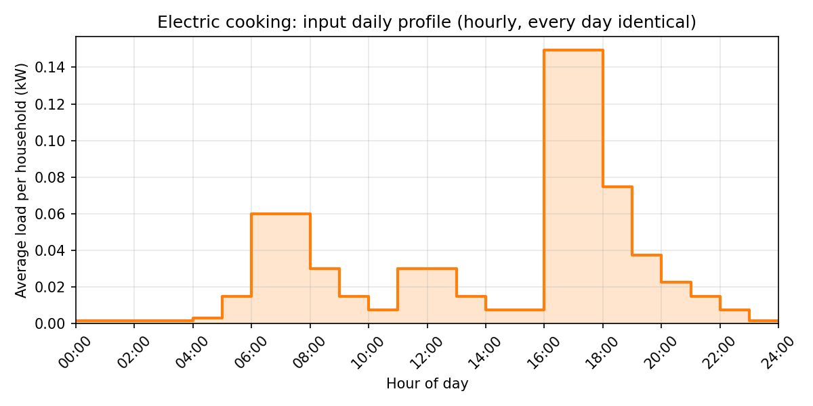

# Gaussian Model for Electric Cooking

This document records how the Gaussian model (GM) for household electric cooking was derived:
the input data, the background from German distribution-grid literature, the parameter choices,
and the dead ends on the way. It is generated and reproduced by
[`scripts/generate_cooking_gm.py`](../scripts/generate_cooking_gm.py).

## Planning values

| Households $N$ | GM P95 (kW per household) | GM P99 (kW per household) | Rusck $g(N) \cdot 3$ kW (kW per household) |
| ---: | ---: | ---: | ---: |
| 1 | 1.520 | 2.711 | 3.00 |
| 10 | 0.457 | 0.632 | 1.05 |
| 20 | 0.373 | 0.488 | 0.79 |
| 30 | 0.324 | 0.420 | 0.67 |
| 50 | 0.302 | 0.358 | 0.55 |
| 100 | 0.246 | 0.279 | 0.43 |
| 200 | 0.215 | 0.239 | 0.35 |

Rusck column: $g(N) \cdot 3$ kW with $g(N) = g_\infty + (1 - g_\infty)/\sqrt{N}$ and $g_\infty = 0.0498$.

The values are the cooking load at a single 15-minute step at the profile peak (16:00–18:00),
with every day identical, $P_{\max}(1) = 3$ kW and 1,000 Monte Carlo runs. With only 1,000 runs
the percentiles, P99 in particular, are approximate. GM values are taken from
`results/electric_cooking_pmax_3kW.csv`.

> **Not conservative:** the GM lies about 34 % (RMS) below Rusck's curve for intermediate $N$, so
> it gives lower group peaks than planning practice. Do not use it on its own to dimension feeders
> or connections. For the reason, see
> [section 6](#6-comparison-with-rusck-and-limitations).

## Model parameters

| Quantity | Value | How it is obtained |
| --- | --- | --- |
| Diversified peak $P_{\text{peak}}$ | 0.1494 kW per household | maximum of the input profile (16:00–18:00) |
| Maximum load of one household $P_{\max}(1)$ | **3 kW** | chosen as a compromise (see [section 4](#4-choice-of-p_max--3-kw)) |
| Asymptotic simultaneity $g_\infty$ | **0.0498** | $P_{\text{peak}} / P_{\max}(1)$ |
| Activation probability at the peak $p$ | **10 %** | fixed by choice |
| Location $\mu$ | 1.42 kW (47.4 % of $P_{\max}$) | solved so that the truncated mean fits $P_{\text{peak}}$ |
| Scale $\sigma$ | 3.0 kW (100 % of $P_{\max}$) | calibrated against Rusck's curve (upper bound of the search) |
| Mean active load $E[P_{\text{active}}]$ | 1.494 kW | $= P_{\text{peak}} / p$ |

Outputs: `results/electric_cooking_config.json` (model config) and
`results/electric_cooking_pmax_3kW.{csv,meta.json,png}` (Monte Carlo results).

## 1. Input data

The hourly load is taken from the Quintel Energy Transition Model dataset,
[`Warmtevraagprofielen.xlsx`](https://github.com/quintel/etdataset-public/blob/1cc349a3e6497bc9c84798428524b0278beeeabf/curves/demand/households/space_heating/script/input_data/Warmtevraagprofielen.xlsx)
in `quintel/etdataset-public` (Dutch household demand profiles). It consists of 24 values in kW,
the average load per household for each hour starting at 00:00.



| Property | Value |
| --- | --- |
| Peak | 0.1494 kW (hours 16:00 and 17:00) |
| Secondary peak | 0.0597 kW (06:00 and 07:00) |
| Daily energy | 0.742 kWh |
| Annual energy | 270.9 kWh |
| Peak / daily mean | 4.8 |

Assumption: **every day of the year has the same values.** The script writes the 24 values as a
one-year hourly profile (`input_profiles/electric_cooking_hourly.csv`). The fitter expands it to
15-minute intervals. All 12 month factors and the weekday and weekend factors are therefore
identical. The report lists "February, 16:00" as the critical point only because floating-point
noise breaks the tie between equal months and between 16:00 and 17:00.

The values are **hourly averages over many households.** The diversified 15-minute peak is
likely somewhat higher, which would raise $P_{\text{peak}}$ and $g_\infty$ for a given
$P_{\max}(1)$.

## 2. Background: simultaneity in German grid planning

In German distribution-grid planning, the peak load of a group of households is estimated with
the **simultaneity factor** $g(N)$ (Gleichzeitigkeitsfaktor). It is defined as the maximum load of
the group divided by the sum of the individual maxima
([Groiß 2016](#ref-groiss); [Dickert 2015](#ref-dickert), Anhang 4):

$$
g(N) = \frac{P_{\max}(N)}{N \cdot P_{\max}(1)} .
$$

Dickert notes that Germany adopted this factor (rather than the "diversity factor") for grid
planning. It is computed with the equation by **Rusck (1956)**:

$$
g(N) = g_\infty + \frac{1 - g_\infty}{\sqrt{N}} .
$$

Dickert's derivation of this equation (Anhang 4.1) is relevant for this model in three ways:

1. **Assumptions.** Rusck assumes the load curves of the households are *independent* and
   *normally distributed*. He also assumes that the gap between the maximum and the mean of each
   household is proportional to its standard deviation. The GM uses the same assumptions:
   households are independent, and the maximum is taken at a fixed multiple ($z_{0.99}$) of the
   standard deviation above the mean.
2. **Meaning of $g_\infty$.** In the derivation, $g_\infty$ replaces the ratio of mean load to
   individual maximum, $g_\infty = \bar{P} / P_{\max}(1)$. This is exactly how $g_\infty$ is
   computed here: diversified mean at the peak divided by the maximum of one household.
3. **Typical values.** Rusck's own studies gave $g_\infty = 0.10$ to $0.20$ for urban households
   ($P_{\max}(1) = 2.3$ kW), and $0.15$ for farms.

[Esslinger & Witzmann (2012)](#ref-esslinger) cite Kaufmann's planning values: fully electrified
households (no electric space heating, but instantaneous water heaters) have a peak of 30 kW and $g_\infty = 0.06$ to
$0.07$. Their bottom-up stochastic household model, which models cooking appliances (hob, oven)
as their own appliance class, reproduces the Rusck curve well when aggregated.
[Groiß (2016)](#ref-groiss) compares measured simultaneity of 41 prosumer households (Köstendorf,
5-minute data, one year) with the TAEV planning values. The measured household consumption lies
close to the upper bound of the TAEV range.

### Cooking in the planning tables

German planning tables do not list cooking on its own. They distinguish levels of electrification.
"Grundbedarf" (basic demand) means cooking with gas, and "teil-elektrisch" (partly electric) means
basic demand **plus electric cooking** ([Dickert 2015](#ref-dickert), section 3.2.3). Dickert
collects the values in Tabellen A 4-2 and A 4-3:

| Source | Level | $P_{\max}(1)$ in kW | $g_\infty$ | $g_\infty \cdot P_{\max}(1)$ in kW |
| --- | --- | ---: | ---: | ---: |
| Wagner / Bochanky (values for 2010) | Grundbedarf | 7.6 | 0.10 | 0.76 |
| Wagner / Bochanky (values for 2010) | teil-elektrisch | 10.4 | 0.10 | 1.04 |
| Kaufmann (1995) | Grundbedarf | 5 | 0.15–0.20 | 0.75–1.00 |
| Kaufmann (1995) | teil-elektrisch | 8 | 0.12–0.15 | 0.96–1.20 |
| Leder (1964, values for 1984) | teil-elektrisch | 9.6 | 0.15 | 1.44 |

The difference between the two levels can be read as the contribution of electric cooking:

| Source | Added $P_{\max}(1)$ | Added load as $N \to \infty$ | Implied $g_\infty$ of cooking |
| --- | ---: | ---: | ---: |
| Wagner / Bochanky | 2.8 kW | 0.28 kW | 0.10 |
| Kaufmann | 3 kW | about 0.2 kW | about 0.07 |

This differencing is our own interpretation of the tables, not a value stated by the authors. It
assumes the two contributions simply add up. Two things follow from it:

- The added maximum of about **3 kW** per household matches the $P_{\max}(1)$ chosen here.
- The literature values for the large-group load (0.2–0.28 kW) are higher than the 0.149 kW
  peak of the Dutch input profile. Possible reasons are the hourly averaging (section 1), lower
  cooking energy today, and the conservative nature of planning values. The resulting
  $g_\infty = 0.05$ is therefore lower than the implied 0.07–0.10.

## 3. Device ratings

[Dickert (2015)](#ref-dickert) collected the ratings of current German appliances (section 4.5):

- **Hobs** are fused at 16 A. 80 % have four zones with 6–8 kW in total, 20 % have five zones
  with up to 11 kW.
- **Single zones** draw 1.2, 1.4, 1.8, 2.0, 2.2 or 2.4 kW. Induction boost reaches 3.7 kW.
- **Ovens** typically draw 3.5 kW.
- Dickert assumes that all zones of a hob are never used at the same time. His load synthesis
  models three zones (large, medium, small), each with a high-power first step (searing,
  bringing to the boil) and a longer low-power second step (simmering).

For comparison, US and UK design rules (non-German) give:

- The US NEC (Table 220.55, Column C) assumes 8 kW for one range, 2.5 kW per range for 10
  ranges, and 25 kW + 0.75 kW per range above 30 ranges. This tends towards $g_\infty \approx 0.09$
  relative to 8 kW.
- The UK BS 7671 cooker rule (10 A plus 30 % of the remainder) gives about 4.6 kW for one
  10 kW cooker.

These are design rules, not measurements, and US ranges are larger appliances on split-phase
240 V supplies. They mark an upper bound rather than a typical value for European devices.

## 4. Choice of P_max = 3 kW

$P_{\max}(1)$ is the one free physical parameter. Because $g_\infty = P_{\text{peak}} / P_{\max}(1)$,
choosing it also fixes $g_\infty$:

| $P_{\max}(1)$ | $g_\infty$ |
| ---: | ---: |
| 1.5 kW | 0.100 |
| 3 kW | 0.050 |
| 4.6 kW | 0.032 |
| 8 kW | 0.019 |

**3 kW is a compromise** between a realistic maximum and what the model handles well:

- **Realism.** The real maximum of one household can be higher, e.g. two large zones plus the
  oven, or induction boost. For European devices it is not as high as the US design values
  suggest. 3 kW roughly matches two to three zones at once or one zone on boost, and it matches
  the 2.8–3 kW that German planning tables add for electric cooking (section 2).
- **Numerical behaviour.** With $p = 10$ % the mean active load must be $g_\infty / p$ of
  $P_{\max}$. At 3 kW that is 50 %: the truncated Gaussian sits in the middle of $[0, P_{\max}]$
  and $\mu$ and $\sigma$ are well defined. At 8 kW it would be 19 %, which needs strong
  truncation at 0. The gap to Rusck's curve would also be larger (section 6).

## 5. How the parameters are determined

### 5.1 First attempt: $g_\infty = 0.1$ with the fitter defaults

The repository's fitter (`--from-year-profile`) sets $\mu = g_\infty / p$ and
$\sigma = (1 - \mu) / z_{0.99}$ with $p = 1$ by default. For $g_\infty = 0.1$ this gives $\mu$ =
10 % and $\sigma$ = 39 % of $P_{\max}$. The truncation at 0 then raises the mean active load
to 3.4 times $\mu$, so the model's asymptotic simultaneity becomes about 0.35 instead of 0.1. The
fitter's design relation uses the location $\mu$ instead of the truncated mean, and it breaks
down for small $g_\infty$.

### 5.2 Intermediate step: on/off load

Setting $p = g_\infty$ turns the GM into an on/off load ($\mu = P_{\max}$, $\sigma = 0$). With
$g_\infty = 0.1$ ($P_{\max} = 1.5$ kW) this tracked Rusck's curve within about 0.02 from
$N = 5$ on. However, 1.5 kW is not a realistic maximum (section 3), which led to choosing 3 kW.

### 5.3 Final calibration: fixed $p$, fitted $\mu$ and $\sigma$

With $P_{\max} = 3$ kW and $p$ fixed at 10 %:

1. **Mean.** $\mu$ is solved so that the truncated mean meets the profile exactly:
   $p \cdot E[P_{\text{active}}] = P_{\text{peak}}$, i.e. $E[P_{\text{active}}] = 1.494$ kW. This
   guarantees $g(N) \to g_\infty$ for large groups.
2. **Variability.** $\sigma$ is chosen to minimise the root-mean-square relative deviation of the
   simulated $g(N)$ from Rusck's curve for $N = 1 \dots 200$. The simulated $g(N)$ uses the 99th
   percentile of the summed load (20,000 runs, common random numbers).

The search for $\sigma$ ends at its upper bound ($\sigma = P_{\max}$). Beyond that the truncated
Gaussian is almost uniform on $[0, 3]$ kW and adds no further variability.

**Why $\mu$ = 1.42 kW and not 1.5 kW.** $\mu$ is the location of the underlying normal
distribution, not the mean. With a very wide $\sigma$, the truncated density on $[0, 3]$ kW is
nearly flat with a slight bump at $\mu$. Because the interval is centred on 1.5 kW, the part
above $\mu$ is longer than the part below, and the mean (1.494 kW) lies above $\mu$. The
$z_{0.99}$ of the fitter's default $\sigma$ plays no role here, since $\sigma$ is set explicitly.

## 6. Comparison with Rusck and limitations

| $N$ | 1 | 2 | 5 | 10 | 20 | 50 | 100 | 200 |
| --- | ---: | ---: | ---: | ---: | ---: | ---: | ---: | ---: |
| Rusck, $g_\infty = 0.0498$ | 1.000 | 0.722 | 0.475 | 0.350 | 0.262 | 0.184 | 0.145 | 0.117 |
| GM (calibration) | 0.889 | 0.484 | 0.312 | 0.218 | 0.162 | 0.116 | 0.095 | 0.080 |

The GM stays about 34 % (RMS) below Rusck's curve for intermediate $N$. The asymptote matches.
This is a structural limit, not a calibration problem:

- With a mean of $g_\infty P_{\max}$ and a cap at $P_{\max}$, the load of one independent
  household can vary at most like an on/off load with $p = g_\infty$. Its variance is
  $g_\infty (1 - g_\infty) P_{\max}^2$.
- Even that extreme (on/off at 3 kW with $p = 5$ %) gives $g(10) = 0.30$ against Rusck's
  0.35.
- Rusck's curve at such a low $g_\infty$ therefore needs more variability than independent
  households capped at $P_{\max}$ can provide. In practice, Rusck-type planning values also cover
  households behaving alike (common meal times) and safety margins.

**For dimensioning, this GM gives lower group peaks than a Rusck curve with the same
$g_\infty$.**

Further limitations:

- **Maximum versus percentile.** Rusck's $P_{\max}(N)$ is the maximum over an observation period
  (e.g. one year). The GM uses the 99th percentile, because the true maximum of the model is
  always $N P_{\max}$. A higher percentile (about 99.7 % for one peak time step per day) would
  raise $g(N)$ towards Rusck. The percentile is currently fixed at 99 % and was left unchanged.
- **Data basis.** The profile is Dutch (Quintel), while the context values are German planning
  values from 1956–2010. Cooking habits, appliance efficiency (induction) and gas penetration
  differ.
- **Hourly resolution.** See section 1.

## 7. Reproduction

```bash
python scripts/generate_cooking_gm.py                       # P_max = 3 kW, p = 10 %
python scripts/generate_cooking_gm.py --p-max 4 --max-p-on 0.08
scripts/reproduce.sh                                        # regenerates all results
```

The script prints the calibration table (GM against Rusck) on every run.

## References

- <a id="ref-dickert"></a>**Dickert, J. (2015).** *Synthese von Zeitreihen elektrischer Lasten
  basierend auf technischen und sozialen Kennzahlen – Grundlage für Planung, Betrieb und
  Simulation von aktiven Verteilungsnetzen.* Dissertation, Technische Universität Dresden.
  <https://d-nb.info/1105876764/34>. Used here: section 2.2.1 (planning assumptions), 3.2.3
  (levels of electrification), 4.5 (appliance ratings, hobs and ovens), Anhang 4 (derivation of
  Rusck's equation, Tabellen A 4-2 and A 4-3).
- <a id="ref-esslinger"></a>**Esslinger, P.; Witzmann, R. (2012).** *Entwicklung und Verifikation
  eines stochastischen Verbraucherlastmodells für Haushalte.* 12. Symposium Energieinnovation,
  TU Graz. Technische Universität München.
  <https://www.tugraz.at/fileadmin/user_upload/Events/Eninnov2012/files/lf/LF_Esslinger.pdf>
- <a id="ref-groiss"></a>**Groiß, C. (2016).** *Analyse der Gleichzeitigkeitsfaktoren von
  Prosumer-Haushalten mit Elektrofahrzeugen.* 14. Symposium Energieinnovation, TU Graz.
  <https://www.tugraz.at/fileadmin/user_upload/Events/Eninnov2016/files/kf/Session_G3/KF_Groiss.pdf>
- **Rusck, S. (1956).** "The Simultaneous Demand in Distribution Network Supplying Domestic
  Consumers." *ASEA Journal* 10 (11), pp. 59–61. Cited after Dickert (2015).
- **Kaufmann, W. (1995).** *Planung öffentlicher Elektrizitätsverteilungs-Systeme.* Frankfurt am
  Main: VWEW-Verlag. Cited after Dickert (2015) and Esslinger & Witzmann (2012).
- **Wagner, R. (1980).** "Elektrischer Leistungsbedarf in Wohngebieten." *Elektro-Praktiker* 34 (7),
  pp. 220–223. **Bochanky, L. (1985).** *Planung öffentlicher Elektroenergieverteilungsnetze.*
  Leipzig: VEB Deutscher Verlag für Grundstoffindustrie. **Leder, U. (1964).** "Planung von
  Niederspannungsnetzen." *BBC-Nachrichten* 46 (11), pp. 577–583. All cited after Dickert (2015).
- **Quintel.** *etdataset-public*, `Warmtevraagprofielen.xlsx` (commit `1cc349a`).
  <https://github.com/quintel/etdataset-public/blob/1cc349a3e6497bc9c84798428524b0278beeeabf/curves/demand/households/space_heating/script/input_data/Warmtevraagprofielen.xlsx>
- **NFPA 70 (NEC), Table 220.55**: demand loads for household cooking appliances.
  <https://electricaltoolbox.com/range-demand-load-calculator/>
- **BS 7671, Appendix 1**: cooker diversity. Summary at
  <https://wiki.diyfaq.org.uk/index.php/Diversity>
